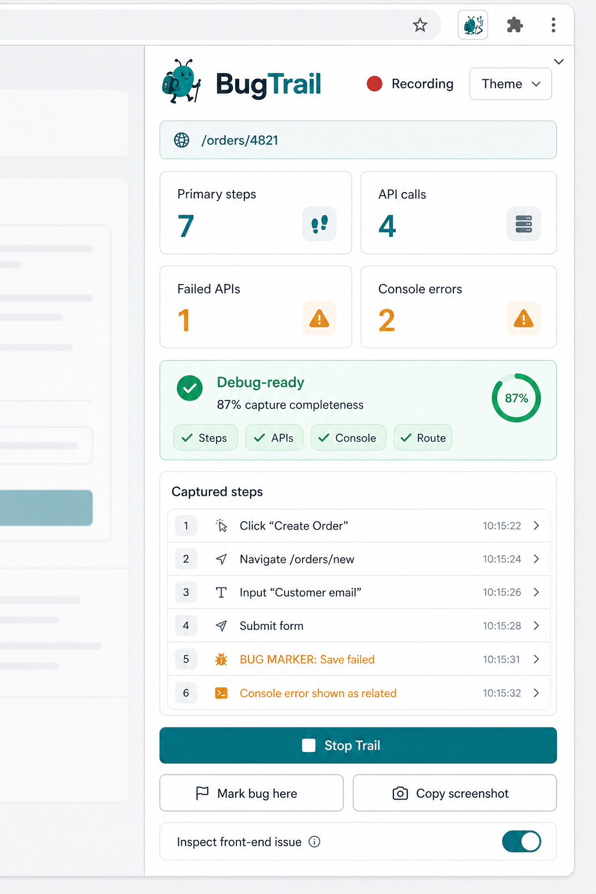

<p align="center">
  
</p>

<h1 align="center">BugTrail</h1>

<p align="center">
  <strong>Local-first Chrome extension for QA → developer handoff.</strong><br />
  Record a reproduction trail. Export one clean Markdown report.
</p>

<p align="center">
  
  
  
  
</p>

<p align="center">
  
</p>

---

## What it does

BugTrail sits in the browser side panel while you reproduce a bug. It captures the journey developers actually need:

- Clicks, routes, inputs, selects, and submits
- Console errors, warnings, and unhandled exceptions
- API / network summaries (including failed calls)
- Bug markers and optional front-end element inspection
- A Markdown report you can copy or save

Everything stays in the browser. BugTrail has **no backend** and does not upload reports.

---

## Quick start

### 1. Build

Requires **Node.js 20.19+**.

```powershell
npm install
npm run build
```

### 2. Load in Chrome

1. Open `chrome://extensions`
2. Enable **Developer mode**
3. Click **Load unpacked**
4. Select `.output/chrome-mv3`

### 3. Record a trail

1. Open the app you are testing
2. Click the BugTrail icon to open the side panel
3. Confirm app / environment (auto-inferred when possible)
4. Click **Start Trail**
5. Reproduce the issue
6. Optionally click **Mark bug here**, **Inspect front-end issue**, or **Copy screenshot**
7. Click **Stop Trail**
8. Fill in actual / expected result and notes
9. Click **Copy Report** or **Save .md**

Brave uses the same flow at `brave://extensions`.

---

## Install from a shareable zip

For QA pilots, share the built package instead of the full source tree:

```powershell
npm run zip
```

This produces:

```text
.output/bugtrail-extension-0.1.0-chrome.zip
.output/bugtrail-extension-0.1.0-chrome.zip.sha256
.output/release-manifest.json
```

Then:

1. Extract the zip
2. Open `chrome://extensions` (or `brave://extensions`)
3. Enable **Developer mode**
4. **Load unpacked** → select the extracted `chrome-mv3` folder

Full QA install / update notes: [docs/qa-install-guide.md](docs/qa-install-guide.md)

---

## How to use

| Action | When to use it |
| --- | --- |
| **Start Trail** | Begin capturing the reproduction |
| **Mark bug here** | Flag the moment the failure is visible |
| **Inspect front-end issue** | Arm the next click to capture the exact element |
| **Copy screenshot** | Copy the visible app tab to the clipboard |
| **Stop Trail** | Finish recording and draft the report |
| **Copy Report / Save .md** | Hand the report to a developer |
| **Add this site** | Enable BugTrail on a new app (one browser prompt) |

### Site access

Built-in access includes localhost and the Spur rewards-admin environments.

For any other app:

1. Open the app in the browser
2. Open the BugTrail side panel
3. Click **Add this site**
4. Approve the permission prompt

BugTrail remembers that origin. You can remove custom sites from the side panel.

---

## Features

- **Side-panel recording** — stays out of the app UI
- **Step timeline** — clicks, routes, inputs, and bug markers
- **Network evidence** — API summaries correlated to steps
- **Console capture** — errors and warnings with redaction
- **Debug-ready score** — quick check that evidence is complete enough
- **Privacy mode** — tokens, emails, phones, secrets, and similar values are masked
- **Local storage only** — trail data stays in `chrome.storage.local`
- **Light / dark / system themes**

---

## Development

```powershell
npm install
npm test
npm run compile
npm run build
npm run verify
```

Release gate (build + zip + metadata + runtime smoke):

```powershell
npm run verify:release
```

Optional browser path for the smoke test:

```powershell
$env:BUGTRAIL_BROWSER='C:\Program Files\BraveSoftware\Brave-Browser\Application\brave.exe'
npm run smoke:runtime
```

---

## Update an existing install

1. Pull latest / receive a new zip
2. Run `npm install` if needed, then `npm run build` (or extract the new zip)
3. Open `chrome://extensions`
4. Click **Reload** on the BugTrail card

---

## Privacy & permissions

BugTrail is local-first:

- Stores trails in the browser profile only
- Does not send data to a BugTrail server
- Redacts common secrets and PII before report text is shown
- Screenshots are copied to the clipboard on demand and are never stored by the extension

Permission rationale and boundaries: [docs/permissions-and-privacy.md](docs/permissions-and-privacy.md)

---

## Docs

| Doc | Purpose |
| --- | --- |
| [QA install guide](docs/qa-install-guide.md) | Pilot install, verify zip hash, update flow |
| [Permissions & privacy](docs/permissions-and-privacy.md) | What BugTrail stores and why permissions exist |
| [Release notes 0.1.0](docs/release-notes-0.1.0.md) | Pilot release notes |
| [Live pilot checklist](docs/live-pilot-checklist.md) | Capture evidence before wider rollout |
| [Production readiness](docs/production-readiness.md) | Readiness checklist |
| [Signoff review](docs/signoff-review.md) | Signoff checklist |

---

## Troubleshooting

- **Site not enabled** → open the app and click **Add this site**
- **No API calls** → paths should include `/api/`, `/graphql`, or `/rest/`
- **Missing response summaries** → request was captured, but the page fetch/XHR bridge could not read the body
- **Side panel looks stale after rebuild** → reload the extension on `chrome://extensions`

---

## License / distribution

BugTrail 0.1.0 is intended for controlled pilot use. For wider rollout, prefer a private/unlisted Chrome Web Store listing or Chrome Enterprise policy rather than an `.exe` installer.
